<div align="center">

# ZarTrack

**Container trucking & logistics management system built with Laravel.**

One platform for the public company profile, shipment operations, driver dispatch with live GPS tracking, customer portal, document control, and invoicing.


[Features](#features) · [Screenshots](#screenshots) · [Getting Started](#getting-started) · [Demo Accounts](#demo-accounts) · [Documentation](#documentation)

</div>

---

## Table of Contents

- [Overview](#overview)
- [Features](#features)
- [Screenshots](#screenshots)
- [Tech Stack](#tech-stack)
- [Roles](#roles)
- [Getting Started](#getting-started)
  - [Requirements](#requirements)
  - [Installation](#installation)
  - [Configuration](#configuration)
- [Demo Accounts](#demo-accounts)
- [Testing](#testing)
- [Documentation](#documentation)
- [Status](#status)

---

## Overview

ZarTrack models a real container-trucking workflow end to end: a quote request arrives from the public site, operations create an order, containers are added and assigned to a driver and truck, status moves through a validated state machine, the driver shares live GPS position and uploads proof of delivery, and finance issues and settles invoices.

Every access path is role-scoped. Customers only see their own company's data, drivers only see their assigned containers, and administrative capabilities are split across four administrative roles.

## Features

### Public website

Photo-forward landing page with operational photography, an asymmetric service mosaic, a validated status-flow showcase, a service catalogue, a quote request form, and public shipment tracking by reference. About and Services share a photographic page banner and design-system primitives; the tracking page uses a narrower reading layout. Light and dark themes.

### Operations

Dashboard with live metrics, customer / driver / fleet registries, multi-container orders, driver and truck assignment, validated status transitions, plus shipment timeline and GPS history.

### Driver portal

Mobile-first task list, status updates, browser Geolocation API sharing restricted to in-transit containers, document and proof-of-delivery upload (PDF/JPG/PNG), and issue reporting that raises an exception state.

### Customer portal

Shipment overview, order and container detail, invoice list with PDF download, and authorized document access — scoped to the customer's own company.

### Documents & finance

Document library with authorization-checked downloads, invoice generation with PDF export, payment recording with automatic status recalculation (`unpaid` / `partial` / `paid`), and finance plus operations reports.

### Platform

Six roles enforced by backend middleware, database notifications, activity log, light and dark theme, responsive layouts, and password show/hide toggles on the login form and the three profile password fields.

Full capability matrix: [docs/FEATURES.md](docs/FEATURES.md)

## Screenshots

All captures use the seeded demo data. There are no production secrets in any image.

<div align="center">

**Landing page — full page (light / dark)**

<table>
  <tr>
    <td align="center" width="50%"><a href="public/images/screenshots/landing-page.jpg">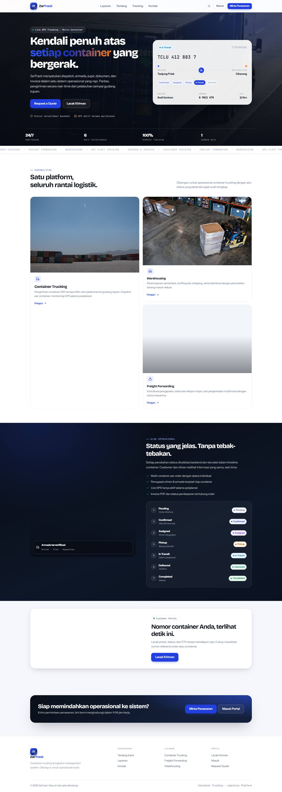</a><br><sub><b>Light theme</b> · 1440 × 4025</sub></td>
    <td align="center" width="50%"><a href="public/images/screenshots/landing-dark.jpg">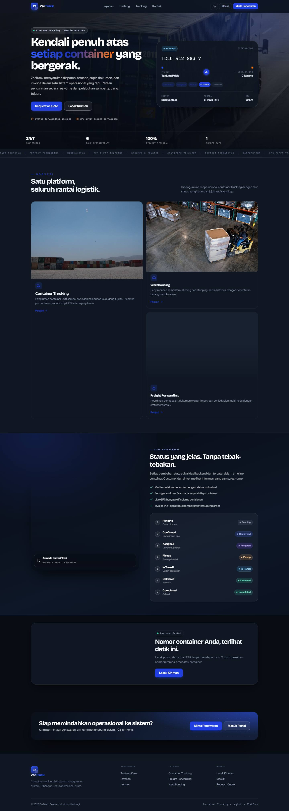</a><br><sub><b>Dark theme</b> · 1440 × 4025</sub></td>
  </tr>
</table>

**Above the fold — desktop hero (light / dark)**

<table>
  <tr>
    <td align="center" width="50%"><a href="public/images/screenshots/landing-desktop-hero.jpg">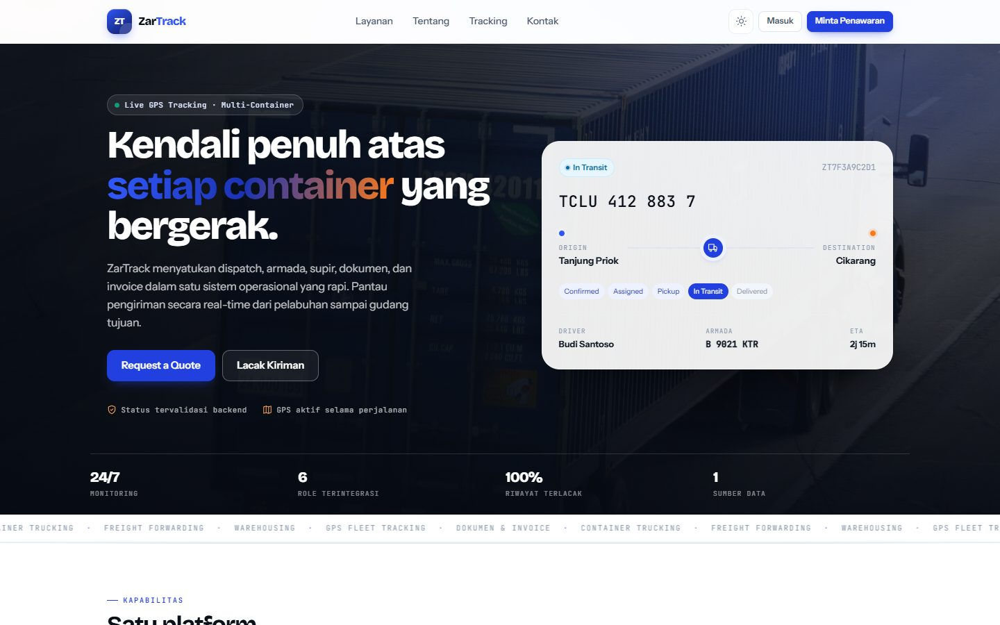</a><br><sub><b>Light theme</b> · 1440 × 900</sub></td>
    <td align="center" width="50%"><a href="public/images/screenshots/landing-desktop-hero-dark.jpg">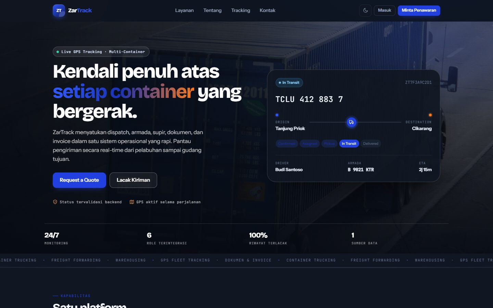</a><br><sub><b>Dark theme</b> · 1440 × 900</sub></td>
  </tr>
</table>

**Responsive landing — tablet and mobile (full page)**

<table>
  <tr>
    <td align="center" width="50%"><a href="public/images/screenshots/landing-tablet.jpg">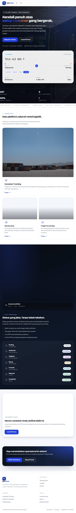</a><br><sub><b>Tablet</b> · 768 × 5175</sub></td>
    <td align="center" width="50%"><a href="public/images/screenshots/landing-mobile.jpg">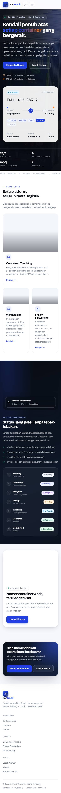</a>&nbsp;&nbsp;<a href="public/images/screenshots/landing-mobile-dark.jpg">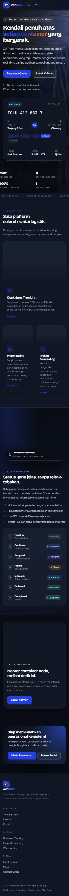</a><br><sub><b>Mobile — light / dark</b> · 390 × 5047</sub></td>
  </tr>
</table>

**Application — admin, portals, and public tracking**

<table>
  <tr>
    <td align="center" width="50%"><a href="public/images/screenshots/admin-dashboard.jpg">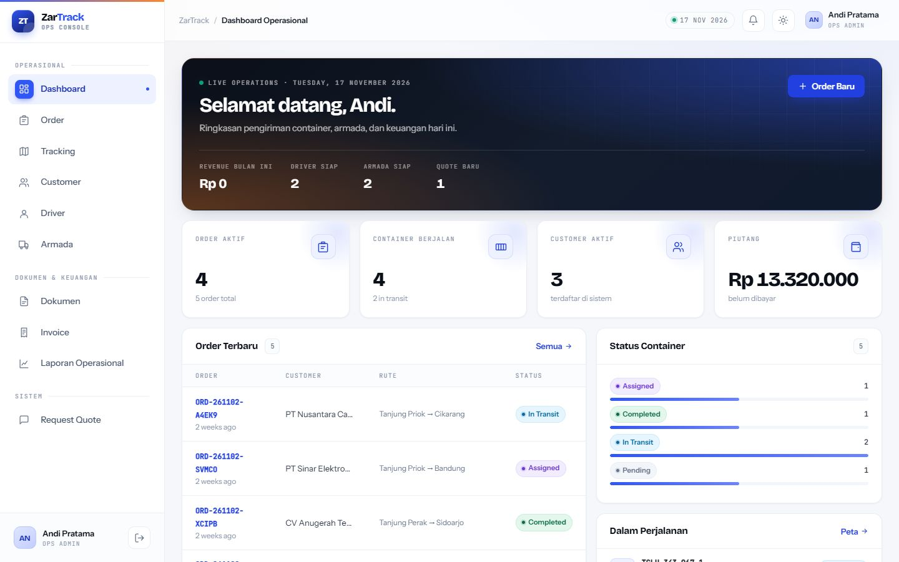</a><br><sub><b>Admin dashboard</b> · 1440 × 900</sub></td>
    <td align="center" width="50%"><a href="public/images/screenshots/shipment-tracking.jpg">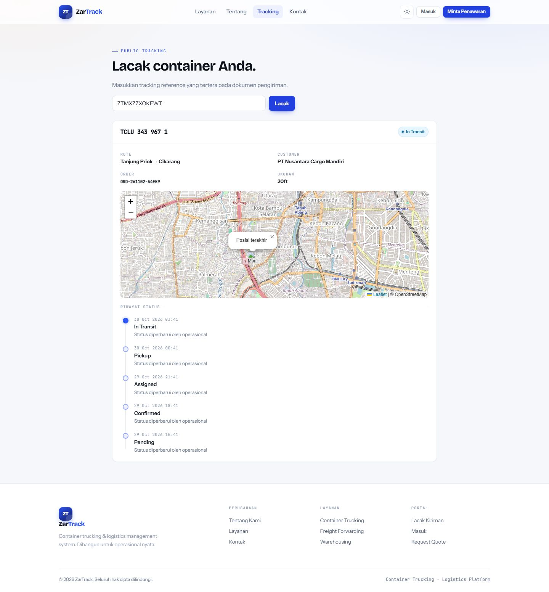</a><br><sub><b>Public shipment tracking</b> · 1440 × 1552</sub></td>
  </tr>
  <tr>
    <td align="center" width="50%"><a href="public/images/screenshots/driver-portal.jpg">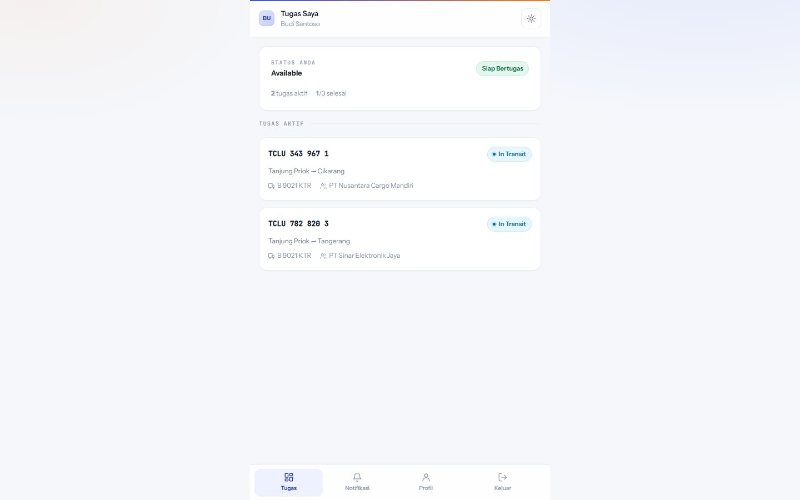</a><br><sub><b>Driver portal</b> · 1440 × 900</sub></td>
    <td align="center" width="50%"><a href="public/images/screenshots/customer-portal.jpg">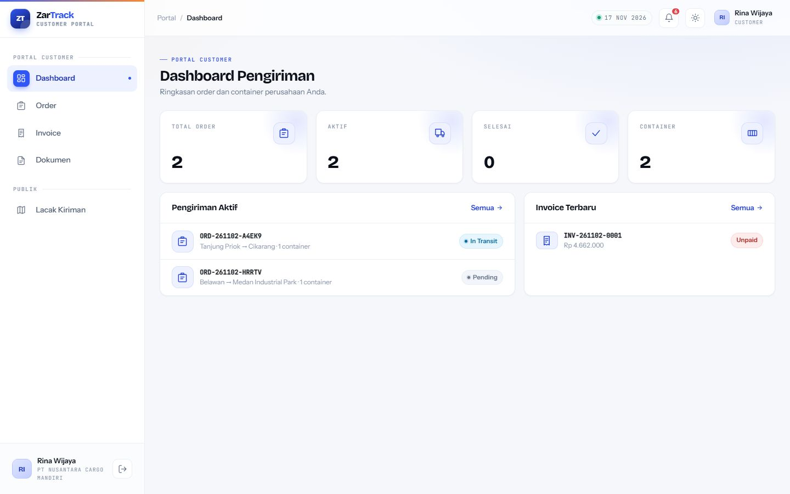</a><br><sub><b>Customer portal</b> · 1440 × 900</sub></td>
  </tr>
  <tr>
    <td align="center" width="50%"><a href="public/images/screenshots/login-password-toggle.jpg">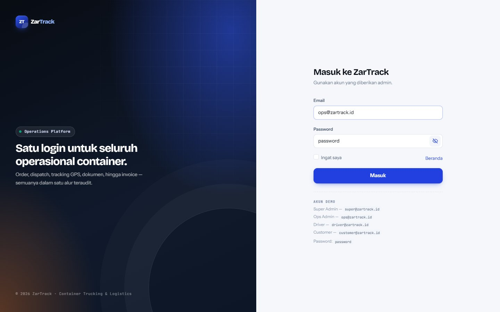</a><br><sub><b>Login — password toggle</b> · 1440 × 900</sub></td>
  </tr>
</table>

</div>

**Capture dimensions.** The viewport sizes used were 1440 × 900 (desktop), 768 × 1024 (tablet), and 390 × 844 (mobile). Landing page captures are full-page screenshots, so their pixel heights exceed the viewport: 1440 × 4025 desktop, 768 × 5175 tablet, 390 × 5047 mobile. The dashboard, portal, login, and hero captures are above-the-fold at 1440 × 900; the public tracking capture is 1440 × 1552.

Operational photography used by the landing page lives in `public/images/photos/` (hero, container stack, container yard, warehouse, port cranes, terminal fleet).

## Tech Stack

| Layer | Choice |
|---|---|
| Backend | Laravel 10.50.4, PHP 8.1+ |
| Views | Blade, Bootstrap 5.3 |
| Assets | Vite 4, custom CSS design system |
| Database | MySQL / MariaDB (SQLite in-memory for tests) |
| Maps | Leaflet + OpenStreetMap tiles |
| Location | Browser Geolocation API |
| PDF | barryvdh/laravel-dompdf 3.1 |

## Roles

| Role | Scope |
|---|---|
| `super_admin` | Full access, user management, activity log |
| `ops_admin` | Orders, dispatch, drivers, fleet, tracking |
| `doc_admin` | Documents, status updates, read-only finance |
| `finance` | Invoices, payments, financial reports |
| `driver` | Assigned tasks, GPS, status, documents, issues |
| `customer` | Own orders, shipments, invoices, documents |

## Getting Started

### Requirements

- PHP **8.1+** with `pdo_mysql`, `pdo_sqlite`, `sqlite3`, `mbstring`, `openssl`, `fileinfo`, and `zip` extensions
- Composer 2
- Node.js **18+** and npm (asset builds)
- MySQL or MariaDB (any local, containerized, or managed server works; no specific control panel is required)
- SQLite is only needed to run the test suite

### Installation

```bash
composer install
```

Create the environment file — use the command for your shell:

```bash
cp .env.example .env        # macOS / Linux / Git Bash
```

```powershell
Copy-Item .env.example .env   # Windows PowerShell
```

Then generate the application key and prepare the database:

```bash
php artisan key:generate
php artisan migrate --seed
php artisan storage:link
npm install && npm run build
php artisan serve
```

The app is served at `http://127.0.0.1:8000`. Alternatively, point an Apache or Nginx virtual host at the project's `public/` directory.

### Configuration

Create the database first (`zartrack` by default), then set the connection block in `.env`:

```dotenv
DB_CONNECTION=mysql
DB_HOST=127.0.0.1
DB_PORT=3306
DB_DATABASE=zartrack
DB_USERNAME=root
DB_PASSWORD=
```

Adjust host, port, and credentials to match your database server. If you prefer a disposable container:

```bash
docker run --name zartrack-db -e MYSQL_ROOT_PASSWORD=secret -e MYSQL_DATABASE=zartrack -p 3306:3306 -d mysql:8
```

Detailed environment setup and troubleshooting: [docs/SETUP.md](docs/SETUP.md)

## Demo Accounts

Sign in at **[`/login`](http://127.0.0.1:8000/login)**. Every seeded account uses the password `password`:

| Role | Email |
|---|---|
| `super_admin` | super@zartrack.id |
| `ops_admin` | ops@zartrack.id |
| `doc_admin` | doc@zartrack.id |
| `finance` | finance@zartrack.id |
| `driver` | driver@zartrack.id |
| `customer` | customer@zartrack.id |

Each role is redirected to its own home after login: admin roles to `/admin`, drivers to `/driver`, customers to `/customer`.

> **Security warning** — these credentials are seed data for local demonstration only. Never deploy the seeded database or these accounts to a public server. Run `php artisan migrate:fresh --seed` only against local data, and set unique passwords before any shared or production deployment.

## Testing

```bash
npm run build
php artisan test
```

Current result:

```text
Tests:    11 passed (83 assertions)
Duration: 1.52s
```

The smoke suite covers public pages, public tracking and quote submission, role guards, admin page rendering, the full shipment-to-payment flow, customer data isolation, driver task isolation, per-role landing pages, and notification creation on status change. Tests run against SQLite in memory, as configured in `phpunit.xml`, so `npm run build` must run first — Blade templates require the Vite manifest.

Responsive layout was also checked manually in Chrome at 1440 / 1024 / 900 / 768 / 600 / 390 / 360 px with zero horizontal overflow, along with the mobile menu, theme toggle, landing image loading, login → role redirect, the password toggle on login and profile fields, and the public tracking timeline with its Leaflet map.

## Documentation

| Document | Purpose |
|---|---|
| [docs/PROJECT_OVERVIEW.md](docs/PROJECT_OVERVIEW.md) | Problem, goals, scope, audience |
| [docs/FEATURES.md](docs/FEATURES.md) | Implemented features per module, with status |
| [docs/BUSINESS_RULES.md](docs/BUSINESS_RULES.md) | Operational rules, status machine, authorization |
| [docs/SYSTEM_ARCHITECTURE.md](docs/SYSTEM_ARCHITECTURE.md) | Layers, data model, request flow, conventions |
| [docs/ROADMAP.md](docs/ROADMAP.md) | Delivered stages, next steps, non-goals |
| [docs/AI_AGENT_GUIDE.md](docs/AI_AGENT_GUIDE.md) | Working instructions for AI coding agents |
| [docs/SETUP.md](docs/SETUP.md) | Install, configure, run, test |

## Status

Core modules are implemented and covered by the smoke suite. See [docs/ROADMAP.md](docs/ROADMAP.md) for the distinction between delivered, in progress, and planned work.

<div align="center"><sub>Portfolio project, built to be extendable into real operations.</sub></div>